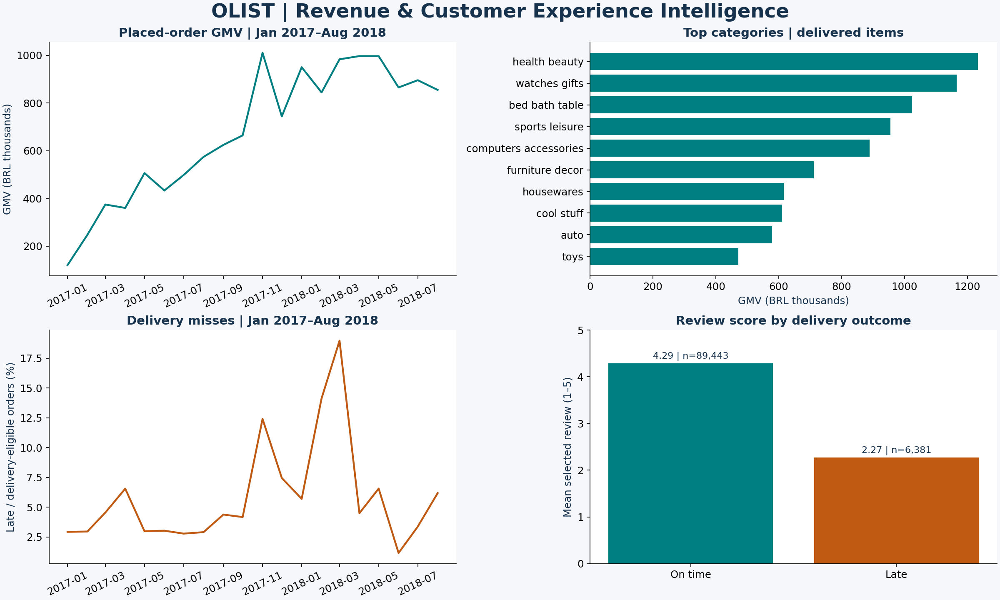
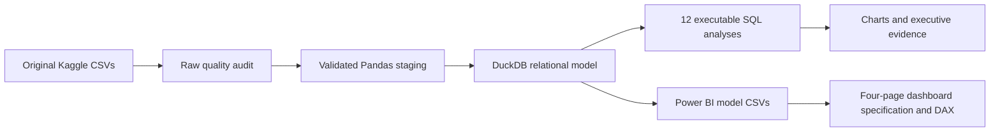
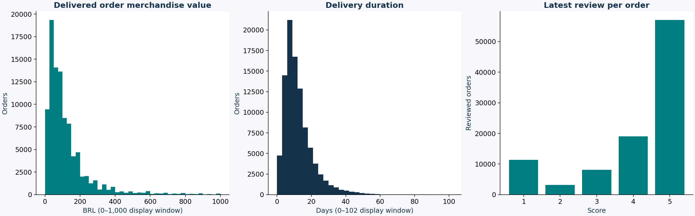
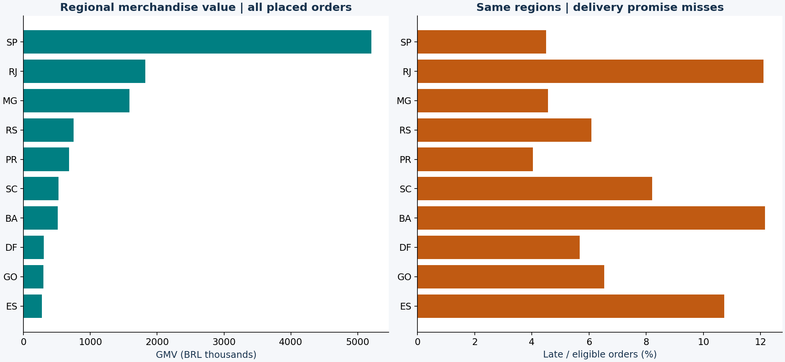

# E-commerce Revenue & Customer Experience Intelligence

A reproducible Olist case study connecting merchandise sales, delivery promises and customer experience. The analysis gives management a way to prioritise operational exceptions, assess category and regional concentration, and investigate payment reconciliation without confusing marketplace GMV with company revenue.



**99,441 orders · 9 original source files · 12 executable SQL analyses · 28 passing tests**

## Live dashboard

**[Explore the interactive dashboard](https://seun-john.github.io/ecommerce-revenue-cx-intelligence/)** · [Source repository](https://github.com/seun-john/ecommerce-revenue-cx-intelligence)

The GitHub Pages version runs all filters and calculations in your browser. No local server, Power BI Desktop, account or installation is needed to view it. The first load downloads approximately 2.8 MB of compressed analytical data. Original order/customer/seller identifiers and review text are omitted; extract-local customer codes support repeat analysis, and seller codes are pseudonyms. Derived data retains the Olist dataset's CC BY-NC-SA 4.0 licence.

The browser engine's KPIs and all nine analytical tables were reconciled against DuckDB across 11 filter populations. See [publication and rebuild instructions](docs/PUBLISHING.md).

## Interactive local dashboard

A working browser dashboard provides all four analysis pages, date/state/status/category filters, KPI cards, clickable regional/category charts, tables and filtered CSV downloads. Run it from this folder:

```powershell
& .venv\Scripts\python.exe -m src.dashboard
```

Open **http://127.0.0.1:8765** in your browser and leave the terminal running. No Power BI Desktop or new packages are required. See the [dashboard guide](dashboard/README.md) for interaction, refresh and verification details. The app queries the actual DuckDB model; it is a functional local alternative to the native Power BI report. Browser automation was disabled during development, so browser layout QA remains manual; API, calculation and renderer checks passed.

## Business questions

- How do monthly merchandise value, order volume and average order value change?
- Which categories and regions contribute the most GMV, and where is shipping-charge burden high?
- Which orders miss delivery promises, and how do reviews differ by delivery outcome?
- How often do observed customers buy again, and which sellers warrant operational review?
- Do item and payment records reconcile, and what can the available data establish about business performance?

## Verified findings

| Finding | Calculated result | Interpretation |
|---|---:|---|
| Placed orders | 99,441 | All recorded statuses |
| Item GMV | BRL 13,591,643.70 | Item prices, excluding freight; not audited revenue |
| Delivered item GMV | BRL 13,221,498.11 | Delivered-status items only |
| Delivered AOV | BRL 137.04 | Delivered GMV / delivered item-bearing orders |
| Late delivery rate | 6.77% | 96,470 delivered orders with both dates |
| Selected review score | 2.27 late vs 4.29 on time | 6,381 vs 89,443 reviewed, delivery-eligible orders |
| Canceled orders | 625 (0.63%) | Canceled / all placed orders |
| Observed repeat share | 3.00% | 2,801 repeat / 93,358 delivered customers; unequal follow-up |

The late-minus-on-time review difference is −2.02 points (bootstrap 95% interval −2.06 to −1.98). This is an unadjusted observational association. The analysis does not show that delays alone caused lower scores or predict the effect of a delivery intervention.

The [executive report](reports/EXECUTIVE_REPORT.md) contains seven specific recommendations with limitations and traceable results. [Exact metrics](reports/metrics.json), [statistical comparison](reports/statistical_comparison.json), and [SQL outputs](reports/sql) support every headline figure.

## Dataset and licence

The **Brazilian E-Commerce Public Dataset by Olist** is provided by Olist on [Kaggle](https://www.kaggle.com/datasets/olistbr/brazilian-ecommerce), under **CC BY-NC-SA 4.0**. This build downloaded the original public Kaggle archive; no mirrored or synthetic data was used for business findings. Source CSV hashes and byte sizes are recorded locally in `reports/source_manifest.json`. The data describes historical 2016–2018 orders.

Code is MIT licensed. Olist source data and derived data/figures retain attribution, noncommercial and share-alike obligations; see [DATA_LICENSE.md](DATA_LICENSE.md). Raw data, database, ZIPs and row-level BI exports are excluded from Git. Synthetic data appears only in explicitly labelled automated test fixtures.

## Methods and architecture

Python/Pandas audits raw schemas, missingness, duplicates, keys, date ranges and referential integrity **before cleaning**. Required monetary values are checked and converted to integer centavos. DuckDB builds an order-grain fact from independent item/payment aggregates and a deterministic latest-review selection. Category and seller analyses retain the correct item or seller-order grain.



| Layer | Main files |
|---|---|
| Acquisition | `src/acquire.py` |
| Audit and validation | `src/quality.py`, `reports/DATA_QUALITY.md` |
| Transformation and exports | `src/pipeline.py`, `sql/schema.sql` |
| SQL analyses | `sql/01_monthly_growth.sql` through `sql/12_reconciliation.sql` |
| Statistics and charts | `src/reporting.py` |
| Tests | `tests/test_pipeline.py` |
| Interactive dashboard | `src/dashboard.py`, `dashboard/` |
| BI handoff | `powerbi/DASHBOARD_SPEC.md`, `measures.dax`, `load_table.pq`, `theme.json` |

The [data model](docs/DATA_MODEL.md) documents all grains and relationships. The [KPI dictionary](docs/KPI_DICTIONARY.md) defines each numerator, denominator, filter population and missing-data rule. Repeated geolocation ZIP prefixes are not joined into facts. Multiple reviews are retained in staging and reduced only for analytical selection. Missing delivery dates are not classified as on-time, and missing reviews are not scored zero.

## Actual analytical graphics

These PNGs are rendered from the executed calculations. They are **Python analytical outputs**, not Power BI screenshots. Trend previews show January 2017–August 2018 to avoid sparse boundary months; the underlying SQL files retain all observed months. Histogram display windows omit tails for readability without excluding records from the metrics.





## Reproduce

From PowerShell in this project folder, with Python 3.12 and its Windows launcher installed:

```powershell
py -3 -m venv .venv
& .venv\Scripts\python.exe -m pip install -e '.[dev]'
& .venv\Scripts\python.exe -m src.pipeline
& .venv\Scripts\python.exe -m pytest -q
```

The pipeline acquires missing files automatically. The [Windows guide](docs/REPRODUCE.md) includes manual Kaggle acquisition, authenticated fallback, exact locked-environment setup, output locations, SQL exploration and Git safeguards. `scripts/run.ps1` runs acquisition, analysis and tests with exit-code checks. No credentials were needed for the delivered dataset download. GitHub Pages publication uses the generated files in `docs/` and the deployment workflow in `.github/workflows/pages.yml`.

## Power BI dashboard

The four-page [dashboard implementation guide](powerbi/DASHBOARD_SPEC.md) specifies Executive Overview, Sales and Product Performance, Delivery and Operational Performance, and Customer Experience. It includes coordinates, visual choices, slicers, drill-downs, accessibility, relationship cardinality, filter direction and Desktop acceptance checks.

The pipeline creates ten model CSVs in `powerbi/exports`. Import them with the supplied Power Query function, apply explicit types, create the documented relationships, add [DAX measures](powerbi/measures.dax), and import the [theme](powerbi/theme.json). Power BI Desktop was not found in the checked installation locations. **No PBIX exists, and DAX has not been executed in Desktop.** Building and validating the native report is the remaining manual step.

## Quality assurance

The test suite covers declared row grains, referential integrity, missing/negative price rejection, invalid dates, unknown categories, latest-review selection, calendar-day lateness, missing delivery/payment/review handling, source-to-model monetary reconciliation, executable SQL and KPI/export consistency. Dashboard tests add filtered KPI reconciliation, category selection without order duplication, empty populations, HTTP/CSV behavior and path restrictions. A synthetic two-item/two-payment/two-review case catches revenue fanout. Real-data integration tests run against the built DuckDB database; data-free CI skips them explicitly. `node scripts/check-dashboard.mjs` checks all four page renderers against the running local API.

Use `reports/run_status.json` to verify the latest run succeeded. The database is built separately and promoted only after analysis completes. Audit/report/export files are written during the batch; do not consume them while a run is active or failed. Package versions are captured in `reports/run_manifest.json` and the complete environment is pinned in `requirements-lock.txt`.

## Limitations and next steps

There are no cost, tax, commission, refund or acquisition-cost records, so profit and recognised company revenue cannot be calculated. Freight-to-GMV is a shipping-charge burden proxy only. Reviews have selection bias; the latest-review policy can affect estimates. Customer follow-up varies and the dataset is historical. Seller-order delivery and review outcomes are shared on multi-seller orders, preventing individual-seller causal attribution. No inflation adjustment is applied.

Useful extensions are mature 90-day repeat-purchase cohorts, adjusted review comparisons by category/state/month, carrier-lane diagnostics, refund and cost ingestion, a scheduled atomic artifact release process, and native Power BI refresh validation. Recommendations should be tested with controlled pilots before treating associations as intervention effects.
