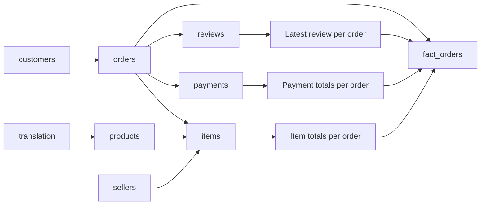

# Analytical data model

`data/olist.duckdb` is rebuilt from immutable source CSVs. Source tables use original column names, parsed timestamps and centavo columns. `sql/schema.sql` creates the analytical tables and view. The audit enforces keys and parent relationships before any analytical tables are built.

| Table | Grain / key | Parent relationships |
|---|---|---|
| orders | order_id | customers.customer_id |
| items | order_id + order_item_id | orders, products, sellers |
| payments | order_id + payment_sequential | orders |
| reviews | raw review record (no asserted unique review_id) | orders |
| customers | customer_id | customer_unique_id is repeat identity, not a unique row key |
| products | product_id | category translation when available |
| sellers | seller_id | No geolocation join |
| translation | product_category_name | English label lookup |
| geolocation | raw observation, repeated ZIP prefix | Audited only |
| fact_orders | order_id | One row per order; item/payment aggregates and selected review |
| dim_products | product_id | Unknown categories retained |
| item_analysis | order_id + order_item_id | One-to-one product and order enrichment |

Item, payment and review tables are never joined together at raw grain. For example, two items, two payments and two reviews create eight raw join rows; `fact_orders` first reduces each child to one row per order. Prices are summed once. Payment totals and item totals remain independently reconciled even when they differ.

DuckDB source/staging tables are loaded by Pandas to retain explicit string identifiers and ZIP prefixes. Integrity is enforced in the validation gate and tests rather than database PK/FK constraints. The process is local, single-writer and rerunnable; close readers before rebuilding. The database is built into `olist.building.duckdb`, validated for order grain and source-to-model money totals, and promoted with an atomic file replacement only after analysis completes. Check exit code and `run_status.json`: report/export files are written during the batch and must not be consumed while running or after failure. A production scheduler should publish all report/export files as an atomic versioned artifact set as well.
